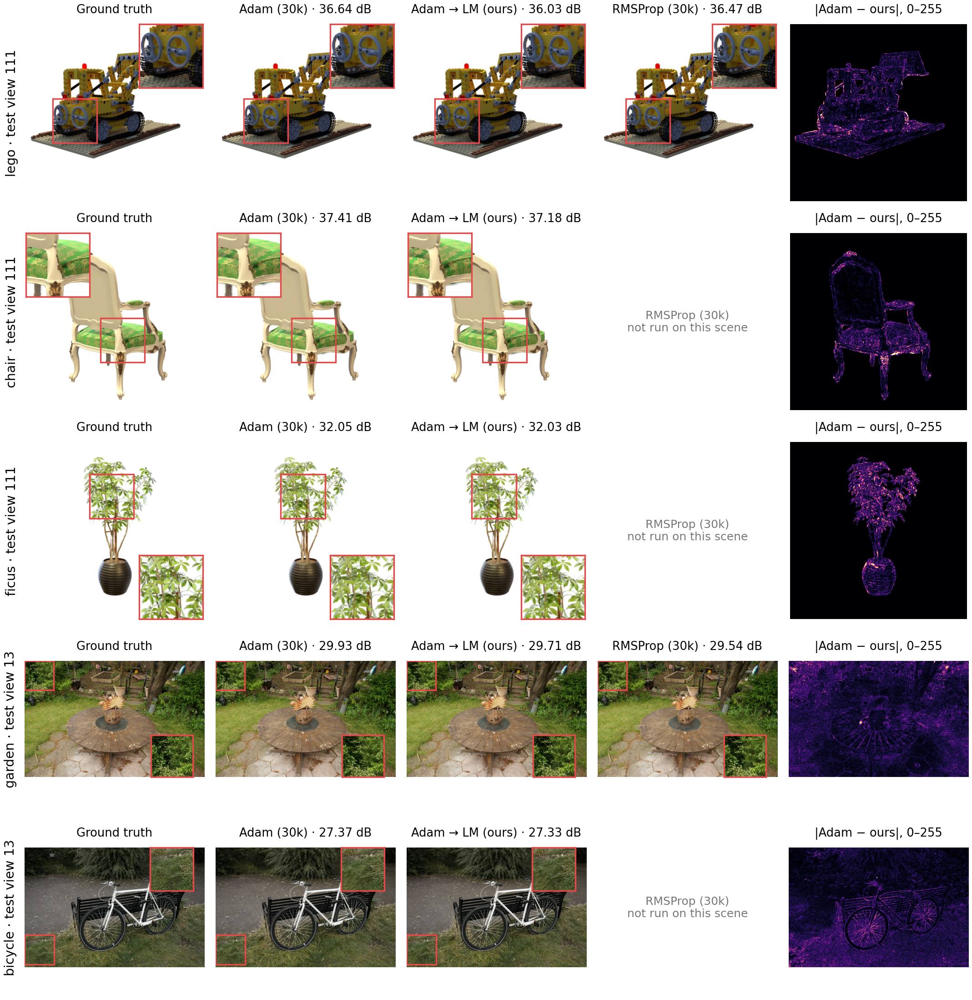
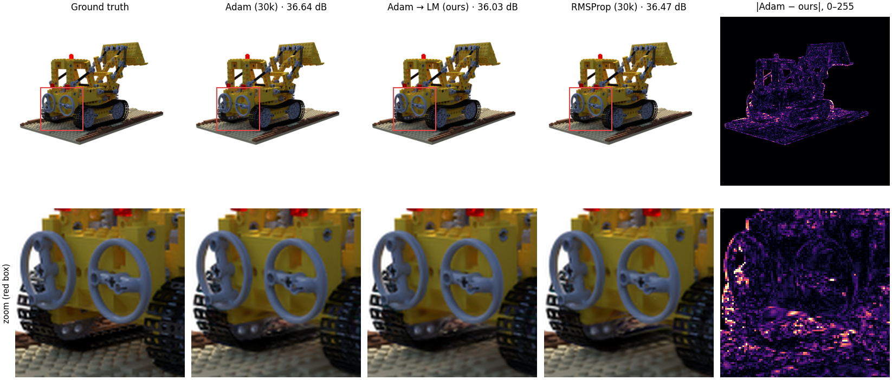
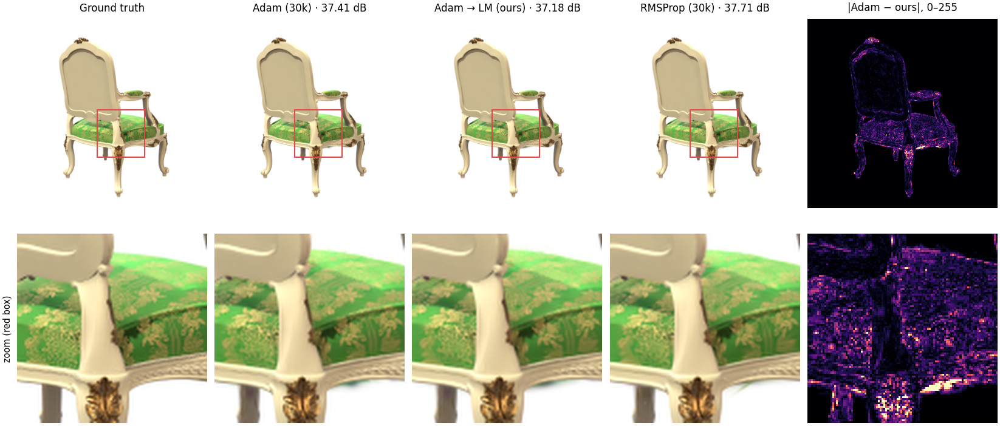
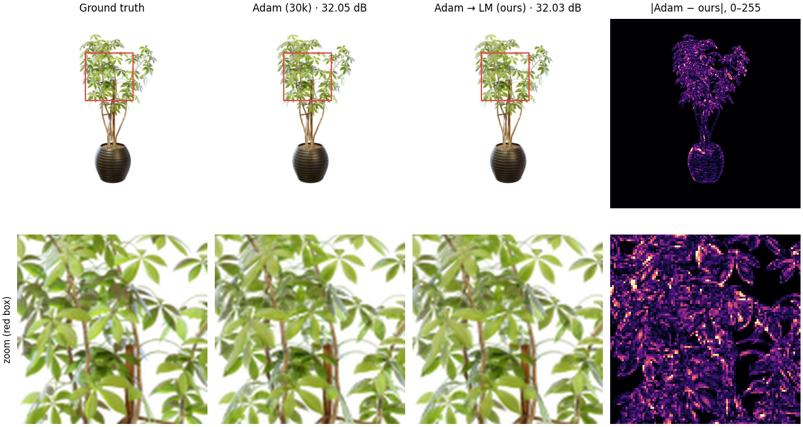
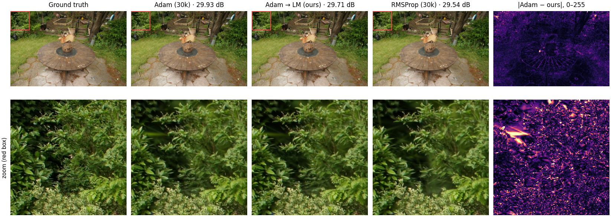
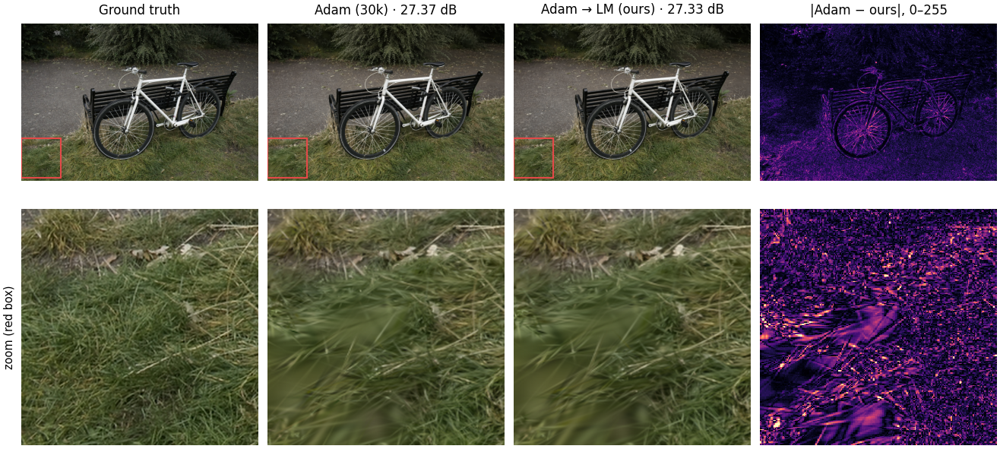
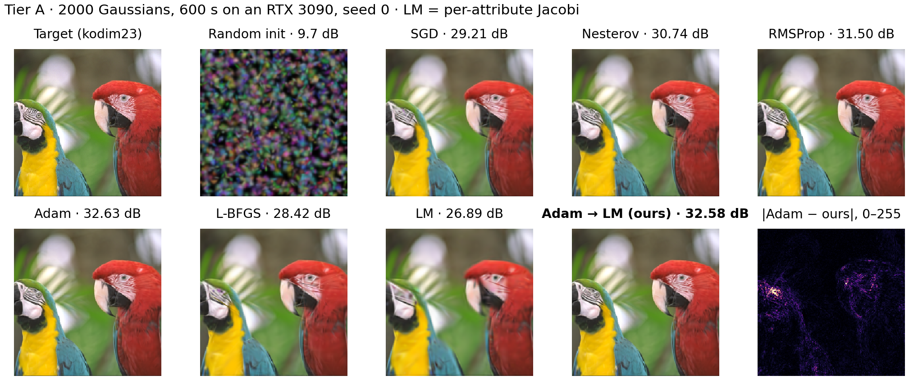

# First-order, adaptive and second-order solvers for 3D Gaussian Splatting

Code and run logs for a COMP6704 (Advanced Topics in Optimization) individual report. It treats the
Gaussian Splatting objective as a constrained, non-convex nonlinear least-squares problem and compares
**SGD, Nesterov momentum, RMSProp, Adam, L-BFGS and matrix-free Levenberg–Marquardt (LM)** on it. It also
proposes an **Adam → LM hybrid** whose LM phase uses a per-attribute Jacobi preconditioner.



## What is compared

Loss: `0.8 · L1 + 0.2 · D-SSIM` between rendered and captured images. Each Gaussian has a position, a scale,
a rotation, an opacity and a colour, with the constraints `s > 0`, `‖q‖ = 1` and `0 ≤ o ≤ 1`.

| Tier | Problem | Renderer | Jacobian products |
|---|---|---|---|
| A | fit one 256×256 image (Kodak `kodim23`) with 2000 alpha-composited 2D Gaussians (20,000 unknowns, 393,216 residuals) | pure PyTorch, no culling (`ia3dgs/model2d.py`) | exact: `Jv` by forward mode, `Jᵀu` by reverse mode |
| B | 3D scenes, standard 30k-iteration 3DGS recipe: NeRF-Synthetic lego, chair, ficus; Mip-NeRF 360 garden, bicycle | [gsplat](https://github.com/nerfstudio-project/gsplat) 1.4.0 | `Jᵀu` exact (backward pass), `Jv` by central finite difference |

Tier A uses its own renderer for a specific reason. gsplat skips a Gaussian at a pixel once its alpha drops
below 1/255, and it clips each footprint at 3σ. The rendered image is therefore only piecewise smooth, and a
finite-difference `Jv` does not match gsplat's backward pass for positions, scales, rotations and opacities.
`tierB/fd_check.py` measures this mismatch.

| Experiment | Question | Where |
|---|---|---|
| E1 | convergence of 9 solver variants, equal 600 s budget, 3 seeds | `tierA/grid.py --exp E1` |
| E2 | step-size sensitivity of the first-order solvers | `tierA/grid.py --exp E2` |
| E3 | curvature: per-attribute blocks of `JᵀJ`, Lanczos spectrum, Adam's `v` vs. `diag(JᵀJ)` | `tierA/spectrum2d.py` |
| E4 | seconds per iteration and peak memory against the number of Gaussians | `tierA/grid.py --exp E4` |
| E5 | constraint handling: reparameterisation vs. projection vs. log barrier | `tierA/grid.py --exp E5` |
| FD | adjoint test of finite-difference `Jv` against gsplat's `Jᵀu` | `tierB/fd_check.py` |
| E6 | real scenes: Adam vs. RMSProp vs. Adam → LM | `tierB/train3d.py` |

## Main results

| | Adam | Adam → LM (ours) | Others |
|---|---|---|---|
| Tier A, PSNR (dB) after 600 s, 3 seeds | 32.77 ± 0.14 | 32.72 ± 0.12 | RMSProp 31.57, Nesterov 30.54, SGD 29.08, L-BFGS 28.77, LM 26.86 |
| lego / chair / ficus, test PSNR (dB) | 35.56 / 37.16 / 33.17 | 35.34 / 37.02 / 33.08 | RMSProp 35.25 / 37.13 / 32.90 |
| garden / bicycle, test PSNR (dB) | 27.36 / 25.17 | 27.37 / 25.17 | RMSProp 27.20 / 25.11 |
| peak GPU memory, garden / bicycle (GiB) | 9.3 / 9.5 | 52.0 / 51.4 | |

Adam's second-moment estimate rank-correlates 0.85–0.92 with the Gauss–Newton diagonal `diag(JᵀJ)` near
convergence (E3), so Adam behaves like a cheap diagonal preconditioner. The hybrid's LM steps are accurate:
every step was accepted on every 3D scene. Each step, however, costs tens of render passes, so the hybrid ties
Adam rather than beating it. Every number in the report is in `results/figures/results.json`.

## Rendered results

The report has room for only one image figure, so the full comparison is here. Each panel shows one test view
per scene: the full frame (top) and an enlarged crop of the red box (bottom), for the ground truth, Adam,
the Adam → LM hybrid and RMSProp, with the test PSNR of that view. The last column is the per-pixel
difference between Adam and the hybrid (0–255).

**lego** (NeRF-Synthetic)


**chair** (NeRF-Synthetic)


**ficus** (NeRF-Synthetic)


**garden** (Mip-NeRF 360)


**bicycle** (Mip-NeRF 360)


**Tier A** (2D image fit after 600 s, every solver)


## Which script makes which report figure

| Report figure / table | File in `results/figures` | Script |
|---|---|---|
| Figure 1 (teaser) | `ia_fig1_teaser.{png,pdf}` | `make_teaser.py` |
| Figure 3 (convergence), Table 1 | `ia_e1_convergence.*`, `results.json` → `E1` | `make_figures.py` |
| Figure 4 (curvature) | `ia_e3_curvature.*` | `make_figures.py` |
| Figure 5 (step size, cost, constraints) | `ia_e245_combined.{png,pdf}` | `make_fig_e245.py` |
| Table 2 (3D scenes) | `results.json` → `E6` | `make_figures.py` |
| Figure 6 (rendered results) | crops of `ia_renders_2d.png`, `ia_renders_3d_lego.png` and `ia_renders_3d_garden.png` | `make_render_figures.py` (the panels) |

Figure 2 (the formulation diagram) is a schematic and is not generated from the logs.

## Installation

Tested on Ubuntu 22.04 with Python 3.10 and CUDA 12.1, on an RTX 3090 (Tier A) and an RTX A6000 (Tier B).

```bash
conda create -n ia3dgs python=3.10 -y && conda activate ia3dgs
pip install torch==2.4.1 torchvision==0.19.1 --index-url https://download.pytorch.org/whl/cu121
pip install --no-deps "gsplat==1.4.0+pt24cu121" --index-url https://docs.gsplat.studio/whl/pt24cu121
pip install -r requirements.txt
pytest -q tests      # 12 checks (6 need CUDA): adjoint tests of the Jacobian products, PCG, Hutchinson, chunking, LM
```

## Reproduce the figures without a GPU

`results/` holds the logs of every run in the report: `log.jsonl` with the curves and `summary.json` with
the final numbers, for each run. It does not include model checkpoints or the full-size 3D test renders.
This command rebuilds every plot and every table value from those logs:

```bash
python make_figures.py --runs results --out results/figures     # CPU only; needs only numpy and matplotlib
python make_fig_e245.py --runs results --out results/figures    # Figure 5: E2, E4 and E5 in one figure
python make_teaser.py                                           # Figure 1: teaser
```

The Tier A image figure (`results/figures/ia_renders_2d.png`) can also be rebuilt from the shipped
`results/tierA/renders/*/final.png`. It needs the Kodak image for the ground truth (`bash tools/download_data.sh kodak`)
and PyTorch for the image loader. The Tier B image figure needs your own Tier B runs.

```bash
python make_render_figures.py --runs results --out results/figures
```

## Data

The datasets are not redistributed here. Fetch each one from its original source, and use it under that
source's terms:

| Dataset | Used for | Source | Command |
|---|---|---|---|
| Kodak Lossless True Color Image Suite (`kodim23`) | Tier A | <https://r0k.us/graphics/kodak/> | `bash tools/download_data.sh kodak` |
| NeRF-Synthetic (lego, chair, ficus), Mildenhall et al., ECCV 2020 | Tier B | <https://github.com/bmild/nerf> ([Google Drive](https://drive.google.com/drive/folders/128yBriW1IG_3NJ5Rp7APSTZsJqdJdfc1), `nerf_synthetic.zip`) | manual; `bash tools/download_data.sh nerf` prints the steps |
| Mip-NeRF 360 (garden, bicycle), Barron et al., CVPR 2022 | Tier B | <https://jonbarron.info/mipnerf360/> (`360_v2.zip`, 12.5 GB) | `bash tools/download_data.sh mipnerf360` |

The resulting layout is shown below. The default location is `data/datasets`; set `IA3DGS_DATA` to use
another folder.

```
data/datasets/kodak/kodim23.png
data/datasets/nerf_synthetic/{lego,chair,ficus}/{transforms_*.json,train/,test/}
data/datasets/mipnerf360/{garden,bicycle}/{images_4/,sparse/0/}
```

New runs write to `runs/` (or `IA3DGS_RUNS`). Each run directory gets `log.jsonl` and `summary.json`.
Every script skips a run whose `summary.json` already exists, so an interrupted job can be resumed by
starting it again.

## Reproduce the experiments

Run the steps in this order. Seeds are fixed. Reported times are optimisation time only; evaluation is
excluded. `bash jobs/env.sh <cmd>` runs a command inside the `ia3dgs` environment from the repository root.

| Step | What | Command | GPU time |
|---|---|---|---|
| 1 | Tier A: step-size pilot → E2 → E1 (9 variants × 3 seeds × 600 s), E5, E4 → E3 | `bash jobs/env.sh bash jobs/tierA_all.sh` | ~6 h (RTX 3090) |
| 2 | Tier B stage 1: lego Adam baseline, FD adjoint check, two LM pilots with 4 views per step | `bash jobs/env.sh bash jobs/tierB_stage1.sh` | ~20 min |
| 3 | Full-batch LM pilots (every attribute / colour / colour + opacity) | `bash jobs/env.sh bash jobs/tierB_pilots_fullbatch.sh` | ~20 min |
| 4 | E6: per scene, the Adam baseline (checkpoint at step 20k), then the hybrid from it with Adam's 20k → 30k time | `bash jobs/env.sh bash jobs/tierB_hybrids.sh` | ~3.5 h (RTX A6000) |
| 5 | E6: RMSProp on every scene | `bash jobs/env.sh bash jobs/tierB_baselines.sh` | ~80 min |
| 6 | Seed 0 of E1 again, saving the rendered images (for the qualitative figure) | `bash jobs/env.sh python tierA/grid.py --exp renders` | ~75 min |
| 7 | All plots and `results.json`, then Figure 5 and the teaser | `python make_figures.py && python make_fig_e245.py && python make_teaser.py` | CPU |
| 8 | Rendered-image figures (needs the datasets for the ground truth) | `python make_render_figures.py` | CPU |

Single runs:

```bash
python tierA/run2d.py --solver adam --lr 0.1 --time_budget 600 --out runs/tmp/adam --save_image 1
python tierA/run2d.py --solver hybrid --lr 0.1 --time_budget 600 --out runs/tmp/hybrid
python tierB/train3d.py --scene lego --method adam            # saves the step-20k checkpoint
python tierB/train3d.py --scene lego --method hybrid --lm_groups color --lm_views 0
```

`tierA/run2d.py` accepts these solvers: `sgd`, `momentum` (Nesterov), `rmsprop`, `adam`, `lbfgs`,
`lm_group` (per-attribute Jacobi, proposed), `lm` (per-coordinate Jacobi), `lm_noprec` (`D = I`) and `hybrid`.
`--mode reparam|project|barrier` chooses how the inequality constraints are handled.

Quick checks (a few minutes): `bash tests/smoke2d.sh` runs every Tier A solver for a few iterations.
`bash jobs/tierB_smoke.sh` runs a short Tier B training with a 30 s LM phase.

The 3D scenes need roughly 10 GB of GPU memory with Adam. The hybrid's full-batch LM phase needs about 4 GB
on the synthetic scenes and more than 48 GB on garden and bicycle (see E6 in the report).

## Layout

```
ia3dgs/
  lm.py          matrix-free Levenberg–Marquardt: PCG, Hutchinson diagonal, per-attribute Jacobi, gain-ratio damping,
                 chunked residuals for full-batch steps
  losses.py      0.8·L1 + 0.2·D-SSIM, PSNR, and least-squares residuals whose squared norm equals the loss
                 (a smoothed |e|, so the Jacobian stays bounded at zero error; optional float64)
  model2d.py     Tier A renderer (2D Gaussians, front-to-back alpha compositing) and constraint handling
  data3d.py      NeRF-Synthetic (Blender JSON) and Mip-NeRF 360 (COLMAP binary) loaders
  paths.py       where datasets, runs and caches live
tierA/           run2d.py (one run, every solver), grid.py (experiment grids), spectrum2d.py (E3)
tierB/           train3d.py (gsplat trainer: Adam, RMSProp, hybrid), fd_check.py (adjoint test)
jobs/            one script per experiment stage (table above); env.sh activates the environment
tests/           unit tests (pytest) and smoke tests
tools/           download_data.sh
results/         logs of every run in the report, and the figures built from them
make_figures.py         every plot and results.json from the logs
make_fig_e245.py        Figure 5 of the report (E2, E4, E5 in one figure)
make_teaser.py          Figure 1 of the report
make_render_figures.py  rendered-image figures (needs the datasets for the ground truth)
```

## Third-party code and licences

The code in this repository is released under the MIT licence (`LICENSE`).

* [gsplat](https://github.com/nerfstudio-project/gsplat) (Apache-2.0) is used as an installed library for
  rasterisation and densification in Tier B. None of its source is copied here. The Tier B learning rates and
  schedule follow its `simple_trainer` defaults, which reproduce the original 3D Gaussian Splatting recipe
  (Kerbl et al., SIGGRAPH 2023).
* LPIPS is computed with [torchmetrics](https://github.com/Lightning-AI/torchmetrics) (Apache-2.0).
* The datasets belong to their authors and are downloaded from the original sources (see *Data*). The
  qualitative figures in `results/figures` show crops of their test images for comparison only.
